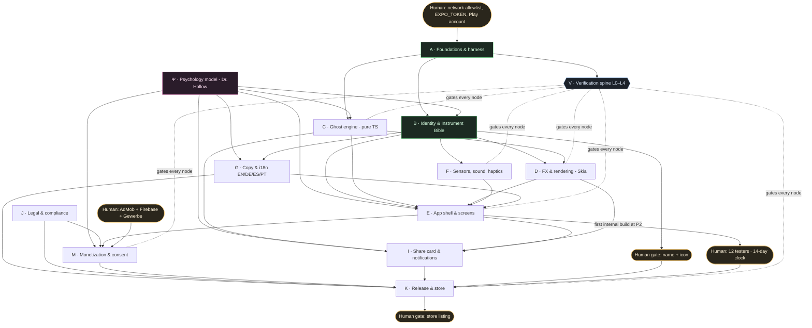

# Ghost Detector: Master Plan

Version 2 · 2026-10-13 · Owner: David · Orchestrator: "Director" (Fable 5.1)

This is the single source of truth for scope, team, sequencing and gates.
Research behind every decision is in `docs/research/2026-10-research-digest.md`.
Live state (what's done, what's next) goes in `PROGRESS.md` and `features.json` once P0 creates them. This file holds the plan, not the status.

---

## 0. Owner decisions (2026-10-13)

| Topic | Decision |
|---|---|
| Orchestrator | A dedicated cloud session on Fable 5.1 (auto mode), with an hourly resume routine |
| Merging | **Auto-merge green phase PRs.** "Green" means CI passed, the Refuter could not disprove the phase claims, and Compliance did not veto. The human gates in §5 still pause the work. |
| Play account | Personal, so the 12 testers × 14 days plan applies |
| Ghost imagery | Find **free, licence-safe** source images (public domain, CC0 or equivalent; e.g. 19th-century spirit photographs on Wikimedia Commons, or CC0 photo libraries) and distort them so they're scarier and match each photo: mattes, displacement, blur, grain, partial occlusion. Every file is logged in `assets/LICENSES.md` with its URL, licence and author. A file with no clear licence doesn't ship. Procedural apparitions remain the fallback. |
| Earlier answers | Expo; EN/DE/ES/PT; instrument look; all ghost features; rewarded + interstitial + banner; Firebase with consent; Android first; the owner picks name, icon and listing |

## 1. What we're building, in one paragraph

An Android-first Expo app that looks and behaves like a piece of real field equipment for paranormal investigation. Point it at your cellar, sweep the room, take a photo, and a 6–10 s analysis runs. You get a "spectral presence" reading, a faint figure composited into the darkest part of your own photo, a thermal view with a cold spot, and (behind a rewarded ad) a full entity profile. Results are simulated and the store listing says so. Inside the app, everything stays in character: telemetry, units, calibration stickers, a needle with mass.

## 2. How this runs autonomously, frictionlessly

Thought through before the plan itself, as asked. Three principles drive it:

1. **State lives in git, not in any agent's head.** Cloud containers get reclaimed and contexts get compacted, so anything that matters is a file:
   - `PROGRESS.md`: current phase, the last thing done, the next 3 things, blockers, and budget used.
   - `features.json`: each feature has `id`, `phase`, `description`, `acceptance`, `evidence`, `passes:false`. Agents may only flip `passes`, and only by attaching evidence.
   - `docs/decisions.md`: append-only panel decisions with scores.
   - `init.sh`: one command to install, build and run the smoke test.

   Every session, or a resumed one, starts the same way: `pwd → git log -20 → PROGRESS.md → init.sh → smoke test`, and only then any work.
2. **Proof beats prose.** A feature counts as done only when there's evidence: a command output, a screenshot path or a Maestro artifact. A Refuter on a *different* model has to fail to disprove it. A fluent "looks good" counts for nothing.
3. **Humans only for taste and identity.** You're asked about the name, the icon, the store listing and three phone checks. Everything else goes to the agent panel and is logged in `docs/decisions.md` for you to skim and override.

### Runtime setup (recommended)

| Piece | Choice | Why |
|---|---|---|
| Orchestrator | A dedicated cloud session on **Fable 5.1** for the `ghost-detector` repo, in auto permission mode | Fable plans, delegates, judges and merges decisions. It never writes feature code, which keeps its expensive context clean and focused. |
| Workers | Subagents in `.claude/agents/*.md`, each pinned to a model (see §3); builders use `isolation: worktree` | Model per role, parallel work without file collisions |
| Fan-out reviews | The Workflow tool for panel votes and verification sweeps (≤10 agents per run) | Deterministic fan-out with resumable runs |
| Keep-alive | An hourly routine: "if idle, read PROGRESS.md and continue the active phase; if blocked, ping David once" | Survives VM reclaim and stalls. A green routine run only means no infrastructure error, so PROGRESS.md is the real check. |
| Branching | One `claude/p<N>-<slug>` branch and one PR per phase. CI must be green. PR auto-fix on. `main` protected. | You merge (or opt into auto-merge of green phase PRs) |
| CI | GitHub Actions: lint (0 warnings), typecheck, unit tests, Expo web export plus Playwright screenshots, and EAS Maestro on demand | Catches regressions without anyone watching |
| Agent teams | **Not used** (experimental, no resume, high token cost) | Subagents plus the Workflow tool cover it more simply |

**Why not Claude Projects?** If Projects is rolled out to your account, a Project with a Fable coordinator and Sonnet threads is an equivalent setup and can replace the orchestrator session. Same files, same rules.

### Seeing the real UI without an emulator

The container has no KVM, so it can't run a local Android emulator. Verification uses five layers, from cheapest to most realistic:

| Layer | What | When | Catches |
|---|---|---|---|
| L0 | `tsc`, ESLint (0 warnings), banned-copy linter, i18n key parity | Every commit | Breakage and slop words |
| L1 | Unit tests on the pure TS engine: dark-region finder, seeded scoring, distribution test, ad-cadence state machine | Every commit | Logic |
| L2 | Expo web export plus Playwright screenshots at 360×800, 390×844 and 428×926, with fixture photos and fixed seeds; golden diffs | Every UI change | Layout, overflow, type, regressions. Skia works on web through CanvasKit; camera, ads and sensors are mocked. |
| L3 | **EAS Workflows → Maestro on an Android emulator** (`takeScreenshot`, `record_screen`), with artifacts pulled via `eas workflow:view --json` and then inspected | End of each feature batch, nightly | The real native render: Skia/Vulkan, fonts, permissions flow, test ads |
| L4 | Your phone, using an internal-testing build from Play | 3 gates only (P2, P4, P8) | Feel: haptics, sound, real camera and sensors |

Optional: Firebase Test Lab (free tier, `gcloud` is already installed) as a second device farm, and EAS Simulator (waitlist) if access comes through.

## 3. The team

| Role | Model | Owns | Never does |
|---|---|---|---|
| **Director** (orchestrator) | Fable 5.1 | The plan, sprint contracts, assignments, PROGRESS.md, the final call on panel ties, PR descriptions | Writing feature code |
| **Dr. Hollow** (Psychology Lead, the core voice) | Opus 5.5 | The engagement model, scare dosing, curiosity gaps, onboarding, retention and monetization psychology. Sits on **every** decision panel and is weighted ×2. | Overriding a Compliance veto |
| **Art Director** | Opus 5.5 (multimodal) | The Instrument Bible, design tokens, screenshot critique with Impeccable critique/audit/polish | Approving its own builder's work alone |
| **Builder A** (app shell and screens) | Sonnet 5.5 | `app/`, `src/ui/`, navigation, state | Touching `src/engine/` |
| **Builder B** (ghost engine) | Sonnet 5.5 | `src/engine/`: analysis, scoring, entity generator, with unit tests | UI |
| **FX Engineer** | Opus 5.5 | `src/fx/`: Skia SkSL (CRT, phosphor, grain, thermal, composite), performance | Copy |
| **Sound & Haptics** | Sonnet 5.5 | `src/audio/`: procedural Geiger, EMF hum, static (react-native-audio-api), haptic patterns | |
| **Copy & Localization** | Sonnet 5.5, plus a separate model check per locale | `locales/{en,de,es,pt}`, field-manual voice, store copy | Using words on the banned list |
| **Compliance Officer** | Sonnet 5.5 | Play policy, AdMob placement, GDPR/TDDDG, Data safety, privacy policy, Impressum. **Hard veto.** | |
| **QA Runner** | Sonnet 5.5 (Haiku 5.5 for log triage) | Runs L0–L3, files evidence, keeps the goldens | Judging taste |
| **Refuter** | Opus 5.5, read-only | Tries to disprove every "done" claim using real artifacts | Accepting prose as evidence |
| **Release Manager** | Sonnet 5.5 | `eas.json`, EAS workflows, versioning, store assets, submit | |

Builders work in their own worktrees on separate file trees, so parallel tracks don't collide.

### Decision protocol (any non-trivial choice)

1. The proposer drafts 2–3 options, including screenshots when the choice is visual.
2. A Workflow fan-out sends the options to Dr. Hollow, the Art Director, the Compliance Officer and the Refuter (plus Release or Copy when relevant). Each scores 1–10 independently, with reasons.
3. Visual A/B comparisons are run twice with the order swapped, to cancel position bias.
4. A Compliance veto wins outright. Otherwise the highest weighted total wins (Hollow ×2), and the Director breaks ties.
5. Append the result to `docs/decisions.md`.

### Design iteration loop (per screen)

Each round goes: build → L2 (and L3 at batch end) → Art Director and Dr. Hollow score against the rubric, with a reference image beside the screenshot → Refuter checks the claims → a fix list → rebuild.

It exits at a mean score of 8 or more with no dimension below 7, **and** all deterministic checks green. Otherwise it stops after 5 rounds and logs the leftovers.

Rubric: reads as real equipment · tension · clarity of the next action · shareability · craft (alignment, type, motion) · "no AI tells" · ad intrusiveness (lower is better).

## 4. The grand scheme: workstreams and how they feed each other

| ID | Workstream | Depends on | Unblocks | Key output |
|---|---|---|---|---|
| A | Foundations & harness | Human H0 | Everything | Expo SDK 57 + dev client, CI, Playwright harness, EAS Maestro workflow, agents and skills, PROGRESS/features/decisions files |
| Ψ | Psychology model | Research | B, C, E, G, I, M | `docs/psych-brief.md`: levers, scare dosing curve, curiosity gaps, ad moments, red lines |
| B | Identity & Instrument Bible | A, Ψ | D, E, F, G, the name gate | A fictional device spec (manufacturer, model, firmware, units, faults), tokens, type, sound palette, voice guide, references |
| C | Ghost engine | A, Ψ | D, E, I | Dark-region finder, seeded score distribution, entity generator, all unit-tested |
| D | FX & rendering | B, C | E, I | SkSL CRT/phosphor/grain/aberration, thermal look-up table, ghost compositor |
| E | App shell & screens | B, C, D, F, G | M, I, the first build | Boot, viewfinder, scan theatre, result, history, settings |
| F | Sensors, sound, haptics | B | E | Magnetometer needle with mass and damping, procedural audio, haptic grammar |
| G | Copy & i18n | B, Ψ | E, K | Locale files, field-manual voice, banned-word lint |
| J | Legal & compliance | Research | M, K | Privacy policy, Impressum, Data safety answers, in-app disclosure, content-rating answers |
| M | Monetization & consent | E, J, Human H3 | K | UMP consent, rewarded Deep Scan, interstitial cadence, banner, Firebase events |
| I | Share card & notifications | C, D, E | K | Watermarked capture card, opt-in local notifications |
| K | Release & store | Everything plus human gates | Launch | Store listing in 4 locales, screenshots, AAB, staged rollout |
| V | Verification spine | A | Gates every node | L0–L4 evidence |

### Critical path

The **14-day closed test** (personal Play account) is the longest wait in the project, so it starts as early as possible. The aim is a first internal-testing build at the end of P2 and the closed-test clock starting at P3, so the two weeks overlap P3–P8 instead of coming after them. Getting a Play account verified can take days, so register **now**.

## 5. Phases

Each phase is one sprint contract: the features in `features.json` with acceptance criteria and required evidence, plus a token budget line in PROGRESS.md.

| Phase | Scope | Runs in parallel with | Exit evidence | Human |
|---|---|---|---|---|
| **P0 Foundations** | Scaffold (SDK 57, expo-router, dev client, TS strict, pnpm), CI, Playwright harness, EAS e2e-android workflow, `.claude/agents/*`, skills (Expo plugin, frontend-design, Impeccable), CLAUDE.md, PROGRESS/features/decisions files, `init.sh` | Ψ research brief | CI green; first L2 screenshot; first L3 Maestro screenshot downloaded | Allowlist, EXPO_TOKEN |
| **P1 Identity** | Psych brief, competitor teardown, Instrument Bible, tokens, type, voice, sound palette, 5 names, 3 icon concepts | (none) | Bible committed; panel scores; name options presented | **Gate 1: pick name and icon direction** |
| **P2 Vertical slice** | Boot → viewfinder → capture → scan theatre → result, with a v0 ghost, EN only, no ads | (none) | Full flow in Maestro video; design loop passed on 4 screens; first AAB on internal testing | **Phone check 1**; invite 12 testers |
| **P3 Ghost engine & FX** | Dark-region finder, apparition library (procedural), compositor with grain applied after compositing, thermal, jump-scare (rare and toggleable), entity profiles | P4, P7 infra | Believability ≥8 on the fixture set (cellar, attic, bright room, pitch black, outdoors); engine tests | Closed test starts |
| **P4 Sensory** | EMF needle on the real magnetometer, live radar sweep, procedural Geiger, hum and static, haptic grammar | P3 | L3 video plus your phone | **Phone check 2** |
| **P5 Monetization & consent** | UMP/TCF consent, rewarded Deep Scan, interstitial cadence, results banner, Firebase after consent, test IDs only | P6 | Compliance sign-off; cadence state-machine tests; L3 shows test ads | AdMob, Firebase, Gewerbe |
| **P6 Retention & share** | Share card (view-shot of Skia), opt-in notifications in the game's voice, investigation log | P5 | Share image renders in L2 and L3 | (none) |
| **P7 Localization** | DE/ES/PT copy written per culture (not literal translation), checked by a second model, layout at the longest strings | P3–P6 | Key parity; L2 in all 4 locales | (none) |
| **P8 Polish & hardening** | Impeccable audit/polish sweep, performance (cold start, scan frame rate), accessibility, crash-free flows, 3 device profiles in Maestro | (none) | Rubric ≥8 everywhere; no regressions against goldens | **Phone check 3** |
| **P9 Launch** | Store listing in 4 locales, 8 screenshots per locale, feature graphic, privacy policy URL, Data safety, IARC rating, apply for production, staged rollout 20% → 100% | (none) | Production live | **Gate 2: approve listing** |
| **P10 Tune** (ongoing) | Analytics-driven: interstitial cadence, scan length, score distribution, retention hooks | (none) | Weekly decision log | (none) |

## 6. "Less AI": the craft rules

These rules bind every agent. The Art Director and the banned-copy linter enforce them.

**Visual**
- Build **one specific fictional instrument** with physical limits, not "a dark theme with green". It gets a full spec sheet:
  - manufacturer, model, serial, firmware and calibration date;
  - real units (mG, ΔT °C, Hz);
  - uneven tick spacing, an oscilloscope-style graticule, a K-II-style LED ladder and a FLIR-style scale bar.
- References: the Alien: Isolation motion tracker (a clunky box that "feels broken"), the K-II meter, FLIR palettes, oscilloscopes, the Pip-Boy bezel.
- **One phosphor hue.** Hierarchy comes from brightness and afterglow, not extra colours. Semantic red appears only for CRITICAL. Neutrals are tinted, never pure black or grey.
- **Imperfections are features:**
  - the needle has mass, overshoot and damping;
  - slight sensor jitter, phosphor persistence and screen burn-in ghosts;
  - a dust and scratch layer.
- **Type:** one terminal face for readouts (VT323) and one technical face for labels (IBM Plex Mono or B612). No Inter, no Space or JetBrains Mono, at most two faces. Licences are checked in P1.
- **Banned tells:** purple or blue gradients; generic cards with one radius and a soft shadow; emoji icons; everything centred; bouncy easing; 01/02/03 markers on things that aren't sequences; arrows on every button.

**Ghosts**
- The look is a double exposure: Screen/Plus blend at 8–25% opacity.
  - Blur the ghost more than the scene and add directional motion blur.
  - Feather the edges with a noise mask and occlude part of the figure.
  - Clamp peak brightness just above the region's mean.
- **Apply the same grain after compositing.** This is the biggest "not pasted in" cue.
- Keep it under 15% of the frame and off-centre. No glowing eyes, no symmetry, no saturated colour.
- Assets are procedural (Skia paths plus FractalNoise displacement). If you want, you can stage 10 photos of a friend in a dark sheet, which gives the most "real photo" feel and is owned outright.

**Copy**
- The voice is a 1980s field manual and calibration sticker: terse, with units and codes, no marketing voice.
- Banned list, linted:
  - words: delve, tapestry, pivotal, crucial, intricate, testament, foster, landscape, underscore;
  - "not X but Y" framing, em-dash asides, and lists that are always three items.

**Sound and haptics**
- Generated in code, not stock: Poisson-timed Geiger clicks, a 50/60 Hz hum with harmonics, filtered static.
- Short, crisp haptic transients, each tied to a reading. No long buzzes.

**Judging**
- Deterministic checks first (contrast, overflow, Impeccable's detector on the web export, goldens).
- Model judges come second: a different model from the builder, with references beside the screenshot and the order swapped.
- You have the last word on taste at the gates.

## 7. Psychology model (Dr. Hollow's charter)

Levers, each with its research and how it's used in the app:

| Lever | Research | In the app |
|---|---|---|
| Priming | Wiseman et al. 2002, Hampton Court: being told about activity raises reported experiences | Location lore before the scan; "activity elevated tonight" (moon phase, 3 AM window) |
| Pareidolia | Riekki et al. 2013: believers detect faces in noise at a looser criterion | Faint, ambiguous, partly hidden figures. Hint, don't show. |
| Fear dosing | Clasen et al. 2020, *Playing With Fear*: enjoyment follows an inverted U | Intensity setting (Calm / Standard / Brave); mostly calm scans, rare spikes |
| Variable ratio | Ferster & Skinner; Schultz 1997, Fiorillo 2003 (dopamine and uncertainty) | Score distribution with rare CRITICAL events; never the same result twice for different photos |
| Barnum effect | Forer 1949 | Entity profiles written to fit any house |
| Peak-end rule | Kahneman 1993 | A polished reveal plus the share card. **No ad on the peak.** |
| Curiosity gap | Loewenstein 1994 | "Signature partially decoded" leads into the rewarded Deep Scan |
| Authority cues | (none cited) | Real magnetometer data, calibration and serial numbers |
| Belief calibration | Onboarding | A one-tap "Have you experienced something unexplained?" sets the intensity and priming |

**Red lines** (from Compliance, not negotiable):
- **Play's own policy:** labelling an app "for entertainment" does **not** exempt it from the deceptive-behaviour policy. So the listing states plainly that readings are simulated, and the first launch shows an in-character "simulation / entertainment" calibration sticker.
- No mimicking Android system alerts. Notifications never pose as real alarms.
- No ad layouts that cause accidental clicks; no interstitial at launch, exit or a peak moment.
- Not aimed at children: target audience 13+ (ideally 16+), no kid-appealing art.

## 8. Monetization rules (AdMob policy plus ratings)

- **Rewarded:** a Deep Scan (full entity profile, high-resolution apparition, EVP line). Opt-in only. This is the main earner: US and DE rewarded ads pay the most.
- **Interstitial:**
  - never in the first session, at app launch or exit, or on the reveal;
  - only at a natural break (returning from a result to the viewfinder);
  - at most one per 2 scans and one per 3 minutes, preloaded.
- **Banner:** only on the history log screen, kept away from buttons.
- Test ad unit IDs and registered test devices until launch. Never click a live ad.
- **Consent:** Google UMP (a certified IAB TCF CMP), required in the EEA/UK. Firebase starts only after consent.
- Reviews in this category punish two things: heavy ads and "same result every time". Both are design constraints here.

## 9. Stack (as of 2026-10)

| Concern | Choice | Notes |
|---|---|---|
| Framework | Expo SDK 57 (React Native 0.86), expo-router, `expo-dev-client` | Expo Go can't run AdMob or Firebase |
| Rendering | `@shopify/react-native-skia` 2.14 | Has web support for L2. v3 (`react-native-skia`, Graphite/Vulkan, API 26+) is to be re-evaluated at P8. |
| Camera / sensors | `expo-camera`, `expo-sensors` (Magnetometer) | `HIGH_SAMPLING_RATE_SENSORS` if <200 ms |
| Audio / haptics | `react-native-audio-api` (procedural), `expo-haptics` | |
| Ads / consent | `react-native-google-mobile-ads` 17.x with AdsConsent (UMP) | |
| Analytics | `@react-native-firebase/app` + `/analytics` 26.x | Consent-gated |
| Notifications / share | `expo-notifications` (local), `react-native-view-shot` / Skia `makeImageSnapshot`, `expo-sharing` | |
| i18n | `i18next` + `expo-localization` | |
| Builds / submit | EAS Build, Workflows (Maestro), Submit (service account → internal → closed → production) | |
| Agent skills | Expo plugin (`expo@claude-plugins-official`), `frontend-design`, Impeccable (`npx impeccable install --providers=claude --scope=project`), project agents | taste-skill is skipped to avoid conflicting rules |

## 10. Your checklist, ordered by what blocks the longest

| When | Step | Blocks |
|---|---|---|
| **Now** | Add `expo.dev` and `*.expo.dev` to this environment's allowed network domains (Network access, then Allowed domains). They are currently blocked. | P0 (EAS) |
| **Now** | Create an Expo account and access token, and add it as `EXPO_TOKEN` in the environment secrets | P0 |
| **Now** | Register a Google Play developer account ($25) and start identity verification. Personal account: 12 testers × 14 days required. Organization account: needs a D-U-N-S number but skips that. | Launch |
| By end of P2 | Create the app in Play Console; create a GCP service account and JSON key with release permission; upload it to EAS (I'll give click-by-click steps) | Internal builds |
| By end of P2 | Collect 12 testers' Gmail addresses (a Google Group is easiest) | 14-day clock |
| By P5 | AdMob account and app ID; Firebase project (download `google-services.json`); Gewerbe registration; an address for the Impressum and the DSA trader display (a c/o service keeps your home private) | Monetization |
| Gates | Name and icon (P1), 3 phone checks (P2/P4/P8), store listing (P9) | (none) |
| Anytime | Drop Pinterest images in `/inspiration` | Design rounds |

Costs: Play $25 once. EAS free tier to start; Starter at $19/month is likely needed once Maestro runs nightly. Firebase and Test Lab free tiers. Apple ($99/year) later.

## 11. Risks

| Risk | Mitigation |
|---|---|
| Play rejection for "impossible functionality" | Plain "simulated" wording in the listing; nothing in the metadata claims real detection |
| AdMob invalid-traffic ban | Test IDs, no self-clicks, policy-safe placements |
| Model judges are biased (position, verbosity, surface polish) | Deterministic checks first, swapped-order A/B, a different judging model, human taste gates |
| Token or cost blowup (multi-agent setups use roughly 15× the tokens of a single chat) | Fable only coordinates; `maxTurns` per agent; ≤10 agents per workflow; budget line per phase; Haiku for triage |
| EAS Maestro is alpha | Firebase Test Lab as fallback; Playwright L2 always available |
| Container reclaimed mid-task | Git-backed state, the hourly resume routine, small commits |
| Revenue expectations | Realistically tens of €/month unless the share card goes viral; the category's top app is estimated at ~$10K/month with about 2.5M installs |
